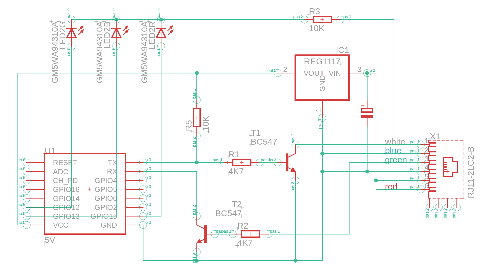

# ESP8266Zasobnik

ESP8266 (Witty Cloud) czytający ramki ze sterownika solarnego TECH (ST-401n) po linii RJ12
i wysyłający wartości przez MQTT do Home Assistant (autowykrywanie).

## Konfiguracja

Skopiuj `ESP8266Zasobnik/secrets.h.example` jako `ESP8266Zasobnik/secrets.h` i uzupełnij
WiFi oraz dane serwera MQTT (np. dodatek Mosquitto w HA).

## Arduino IDE

- Płytka: **NodeMCU 1.0 (ESP-12E Module)**, rdzeń esp8266
- Biblioteki: **PubSubClient** (Nick O'Leary), **HashMap** (Alexander Brevig)

## MQTT

| Temat | Zawartość |
|---|---|
| `tech_solar/status` | `online` / `offline` |
| `tech_solar/temp_solar`, `tech_solar/temp_tank` | °C |
| `tech_solar/mode` | `auto` / `odmrażanie` / `urlopowy` |
| `tech_solar/pump` | `ON` / `OFF` |
| `tech_solar/pump_power` | % |
| `tech_solar/power` | kW (uzysk chwilowy) |
| `tech_solar/energy_daily` | kWh (uzysk dzienny) |
| `tech_solar/energy_week`, `tech_solar/energy_month` | kWh (uzysk tygodniowy, miesięczny) |
| `tech_solar/state` | stan sterownika (157C): praca ręczna / normalna / przegrzanie kolektora / kod |
| `tech_solar/reg_1b9c` | rejestr 1B9C – prawdopodobnie uzysk roczny, do weryfikacji |
| `tech_solar/raw/<rejestr>` | (tylko z `RAW_ENTITIES`) każdy rejestr surowo jako JSON `{"hex":"0062","u":98,"s":98}` (bez znaku / ze znakiem); w HA encja diagnostyczna „Rejestr XXXX” z historią (oprócz zegara 1620) |
| `tech_solar/diag` | JSON: RSSI, czas pracy, ramki, błędy |
| `tech_solar/log`, `tech_solar/debug` | logi |

## Tryby testowe

Na początku `ESP8266Zasobnik.ino`:

- `#define SIMULATE` – bez sterownika: co 5 s sztuczna ramka z poprawnym CRC,
  zmieniające się temperatury (także ujemne) i pompa. Sprawdza całą drogę aż do HA.
- `#define RAW_ENTITIES` (domyślnie włączone) – tryb rozpracowywania rejestrów: każdy surowy rejestr na `tech_solar/raw/<rejestr>` i jako encja diagnostyczna „Rejestr XXXX” w HA z historią. Po zakomentowaniu surowe rejestry nie są wysyłane, a ESP sprząta stare encje z HA i tematy raw z MQTT. Znane encje działają zawsze.
- `#define DEBUG` – dodatkowe komunikaty na `tech_solar/debug`.
  Nie używa `Serial`, bo `Serial` jest podłączony do sterownika.

## Diody (RGB na Witty)

- czerwona – start / brak połączenia z MQTT
- zielona – wysyłanie do MQTT
- niebieska – odbiór bajtów ze sterownika

## Zapis do sterownika (testy)

Nadawanie przez sprzętowy TX (GPIO1) → T1 → pin 1 RJ12, zwykły UART 9600 8N1 (T1 sam odwraca sygnał).
Ramka: `02 26 | adres | rejestr | wartość | 02 18 | CRC`, wysyłana ok. 50 ms po pustym zapytaniu
`0226FFF40218` (lub po dowolnej ramce, jeśli przez 20 s nie było zapytania).

Reguła z forum: rejestr odczytu = 5000 + numer parametru, rejestr zapisu = numer parametru
(np. odczyt `1620` = 5664 → zapis `0298` = 664).

- **automatycznie**: gdy zegar sterownika (`1620`) różni się od NTP o ≥ 2 min, ESP sam go ustawia (nie częściej niż co 10 min; `CLOCK_MAX_DIFF_MIN` w kodzie)
- przycisk **Ustaw zegar sterownika** – czas z NTP na `0298` (bajt godzina, bajt minuty); efekt widać na stronie WWW urządzenia (`1620`, z czasem odbioru wg NTP)
- lista **Tryb pracy** (auto / odmrażanie / urlopowy) – zapis na `037D` (parametr 893, odczyt `1705`);
  jeśli w ciągu 60 s `1705` nie pokaże nowego trybu, druga próba wprost na `1705`;
  wynik w logu: `Tryb_ok_<tryb>_rej_<rejestr>`, `Tryb_brak_potwierdzenia_proba_1705` albo `Tryb_zapis_nie_zadzialal`
- ręczny zapis (bez encji w HA) – opublikuj na temat `tech_solar/cmd/raw`, np. w *MQTT → Konfiguruj → Opublikuj pakiet*: `RRRRVVVV` albo `RRRR VVVV [ADRES] [ODSTĘP_MS]`,
  np. `0298 1118` (17:24), `0298 1118 fff4`, `0298 1118 0000 2` (2 ms między bajtami)
- wysłana ramka: `tech_solar/tx`, logi `TX_...` na `tech_solar/log`

## Aktualizacja przez WiFi (OTA)

Pierwszy raz trzeba wgrać kablem. Potem:

- **Arduino IDE**: *Narzędzia → Port* → port sieciowy **ESP8266Zasobnik at 192.168.x.x**, *Wgraj*,
  hasło = `SECRET_OTA_PASSWORD`. (Windows może zapytać o zgodę w zaporze – zezwól.)
- **Przeglądarka**: w IDE *Szkic → Eksportuj skompilowany plik binarny*, potem `http://IP_ESP:81/update`,
  login `admin`, hasło `SECRET_OTA_PASSWORD`, wybierz plik `.bin`.

W *Narzędzia → Flash Size* musi być opcja z OTA (domyślne dla NodeMCU 1.0: *4MB (FS:2MB OTA:~1019KB)*).

## Schemat

Źródło: `docs/esp8266_tech.sch` (EAGLE 9.7). Uwagi do pliku:
- **R3 pin 2 nie jest podłączony** (przewód kończy się luzem) – na płytce idzie do **GND**, do poprawienia w EAGLE
- IC1 (REG1117) to stabilizator wbudowany w Witty Cloud, a nie osobny element
- C1 na płytce to tantal 100 µF (na schemacie 3,3 µF)

Wyprowadzenia Witty Cloud: [docs/witty-cloud-pinout.jpg](docs/witty-cloud-pinout.jpg) (grafika: schatenseite.de)

Opis połączeń (stan faktyczny na płytce):

| Element | Połączenie |
|---|---|
| RJ12 pin 1 (biały) | RX sterownika ← kolektor T1 (otwarty kolektor, bez pull-upu – pull-up ma sterownik) |
| RJ12 pin 2 (niebieski), pin 4 | GND |
| RJ12 pin 3 (zielony) | TX sterownika → R2 4k7 → baza T2 |
| RJ12 pin 5, 6 (czerwony) | ok. 12 V ze sterownika → VCC Witty (wbudowany AMS1117), tantal 100 µF |
| TXD (GPIO1) | → R1 4k7 → baza T1; R5 10k do VCC (TX w stanie wysokim przy starcie) |
| RXD (GPIO3) | ← kolektor T2 (pull-up wewnętrzny ESP) |
| GPIO12 / 13 / 15 | → zewnętrzne LED G / B / R (anody), wspólne katody → R3 10k → **GND** |

Oba tranzystory odwracają sygnał – linia TECH ma odwróconą logikę (spoczynek ≈ 0 V),
więc ESP nadaje i odbiera zwykłym, nieodwróconym UART-em 9600 8N1.
